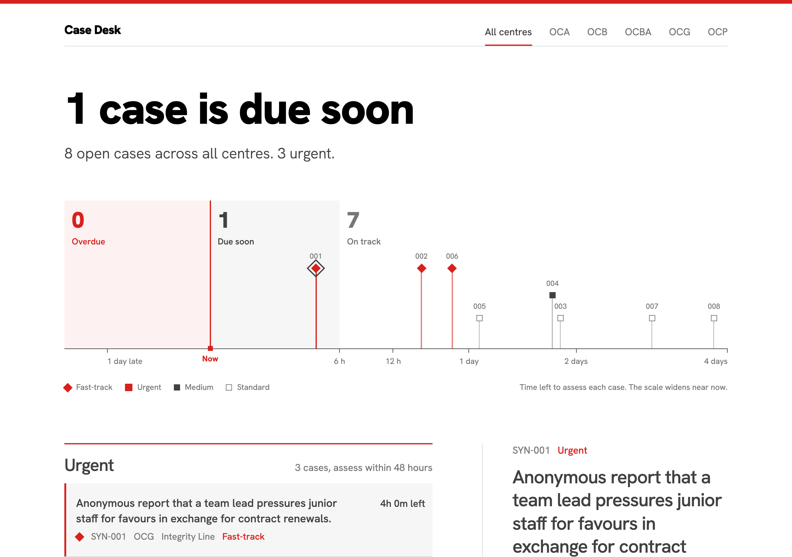
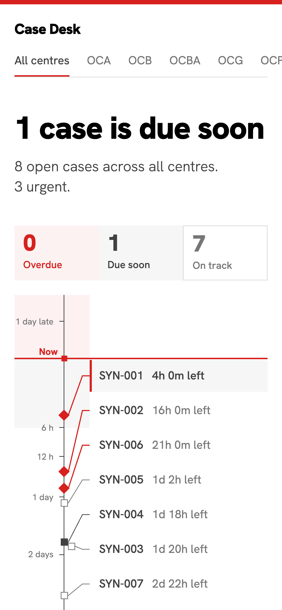
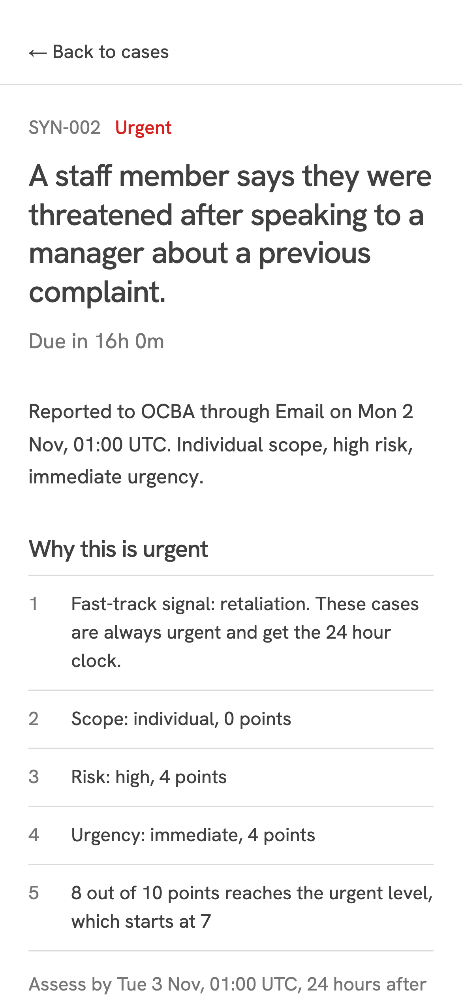

# Case Desk

A prototype for assessing and deciding cases in the ethics and behaviour teams of Metges Sense Fronteres (MSF), across all its operational centres. Built at Universitat Pompeu Fabra for the Project Management course (team 101_E), together with MSF's Ethics & Behaviour Unit.

**Live prototype:** https://iter2.msf-case-desk.workers.dev (sign-in with an account from the team; the first iteration, without sign-in, stays at https://iter1.msf-case-desk.workers.dev)

<p>
  
</p>

Today a case can wait up to two weeks for the next meeting before anyone assesses it. Case Desk shows what needs attention first and why, so a case can go from received to decided without waiting. It is an internal tool for the people who assess and decide cases. It complements MSF's Integrity Line, which takes reports from people, and does not replace it ([context](docs/context.md)).

> All cases are synthetic. No real case data is used or stored.

**Increment 2** adds a backend on Cloudflare. People sign in with a team account, enter cases, and edit the triage rules of each operational centre with a live preview of how the open cases would be grouped. Cases, rules and accounts are saved in one shared database. The home dashboard from increment 1 now shows the saved cases, scored with the rules of their centre. A "Demo controls" toggle in the footer still moves a simulated clock, to watch cases become overdue. The scoring rules are in [`docs/triage-rules.md`](docs/triage-rules.md).

**Increment 1** was a client-side prototype of the home dashboard with synthetic seed cases. It stays online, unchanged, as a frozen snapshot.

## Stack

The project is built on the CAFE stack:

| Layer | Tool | Role here |
| --- | --- | --- |
| **C**loudflare | Workers, static assets, D1 | One Worker per version serves the web app and the API; D1 (SQLite) stores the data |
| **A**lchemy | Infrastructure as Effects | The deployment is one typed program, [`alchemy.run.ts`](alchemy.run.ts) |
| **F**oldkit | Elm Architecture on Effect | The web app: one Model, fact-named Messages, an exhaustive `update` |
| **E**ffect | Schema, services, layers, RPC | The domain model, the storage service, and the typed API shared by the web app and the Worker |

Plus Vite 8, Tailwind 4, Vitest 5, fast-check, TypeScript 7, oxlint and oxfmt, with pnpm workspaces.

## Layout

```text
.
├── alchemy.run.ts          # the deployment stack (Cloudflare, via Alchemy)
├── apps/
│   ├── api/                # the Worker: sign-in, the RPC API, D1 storage
│   │   └── migrations/     # expand-only SQL migrations of the shared database
│   └── web/                # Foldkit single-page app
├── packages/
│   └── domain/             # triage domain: schemas, rules, scoring, the API contract
└── scripts/                # snapshots, migration and compatibility checks
```

The domain package has no UI and no I/O. The scoring engine is a pure function from a case and a rule set to a result with reasons, so it stays the same in the browser, in the Worker and in every frozen version. The API contract (`packages/domain/src/rpc.ts`) is one Effect RPC group that both the web app and the Worker import, so a change to it fails the typecheck on both sides.

## Getting started

You need Node 24.11.1 or later and pnpm.

```sh
pnpm install
pnpm users:add --email you@example.org --name "Your Name"   # prints a password once
pnpm infra:dev    # web app, API and a local database, with live reload
```

`pnpm infra:dev` prints the local addresses (`app` is the latest version). The account file it imports lives in `.local/` and is never committed. To run everything on plain `workerd`, or on your own Cloudflare account, follow [`docs/self-hosting.md`](docs/self-hosting.md).

| Script | What it does |
| --- | --- |
| `pnpm infra:dev` | Runs the web app, the API and a local D1 database |
| `pnpm dev` | Runs the web app alone (no API, so only the sign-in page works) |
| `pnpm users:add` | Adds or updates an account in `.local/users.sql` |
| `pnpm test` | Runs the domain, API and web tests |
| `pnpm typecheck` | Typechecks every package and the infrastructure file |
| `pnpm lint` | Runs oxlint, including the Foldkit and Effect rules |
| `pnpm migrations:check` | Rejects migrations that would break an older version |
| `pnpm compat:check` | Runs each frozen version's storage tests on the latest schema |
| `pnpm build` | Builds the production bundles |
| `pnpm check` | Runs typecheck, lint, the migration check, tests and build, as CI does |

## Testing

- **Property tests** (fast-check) on the scoring engine: a fast-track signal always makes a case urgent, raising a factor never lowers the priority, scores stay in range, results are deterministic, and every result explains itself.
- **Story tests** (Foldkit) drive the `update` function with Messages and assert on the Model.
- **Scene tests** (Foldkit) render the real view and interact with it through accessible locators, with no browser: sign-in, case entry, the rules editor and the empty and error states.
- **API tests** run the Worker's routes, the RPC procedures and the sign-in flow against the in-memory repository, and the D1 repository against Node's built-in SQLite with every migration applied. One repository contract suite runs against both.
- **Compatibility tests**: rows a newer version might write (unknown values, `NULL` columns, unknown columns) are always read and scored, and `pnpm compat:check` runs the storage tests of every frozen version against the latest schema.

## Deploying

Everything runs on Cloudflare's free plan, declared in [`alchemy.run.ts`](alchemy.run.ts):

| Address | What it serves |
| --- | --- |
| `app.<subdomain>.workers.dev` | The latest version, web app and API |
| `iter1.<subdomain>.workers.dev`, `iter2...` | Each delivered iteration, frozen at its git tag |

All versions share one D1 database, so every snapshot keeps working within its own features while the latest version moves on. The rules that make this safe (expand-only migrations, tolerant readers, column-specific writes) are in [`docs/compatibility.md`](docs/compatibility.md). Only the `app` deployment applies migrations.

```sh
pnpm exec alchemy profile edit --add Cloudflare   # once
pnpm snapshots:prepare                            # extract the frozen iterations
pnpm infra:plan                                   # preview changes
pnpm infra:deploy                                 # deploy
```

The step-by-step guide, for a local `workerd` run or your own Cloudflare account, is [`docs/self-hosting.md`](docs/self-hosting.md).

> [!NOTE]
> Alchemy v2 and Foldkit are both in beta. Versions are pinned exactly, and the reason for the two Effect versions in this repository is explained in [`docs/decisions.md`](docs/decisions.md).

## Design and branding

The interface follows [MSF's branding guidelines](https://branding-guidelines.msf.es/eng/): a white page, MSF red (`#D7211E`) to highlight, dark grey text, square corners and a heavy grotesque headline. Atlas Grotesk, MSF's typeface, is licensed and not included, so the font stack falls back to the open-licence Hanken Grotesk. The footer shows the positive logo, and all branding lives in [`apps/web/src/brand.ts`](apps/web/src/brand.ts) and [`apps/web/src/styles.css`](apps/web/src/styles.css).

## Roadmap

| Increment | Window | Scope |
| --- | --- | --- |
| 1 | until 25 Oct 2026 | Project setup, domain model, scoring engine, home dashboard |
| 2 | until 6 Nov 2026 | Case entry, editable rules per operational centre, saved data, backend on Cloudflare, sign-in |
| 3 | until 20 Nov 2026 | Asynchronous votes and approvals, audit log, roles, KPI view, simulation |
| Closure | until 29 Nov 2026 | Hardening, self-hosting guide, documentation, final demo |

## Licence

MIT. See [LICENSE](LICENSE).
