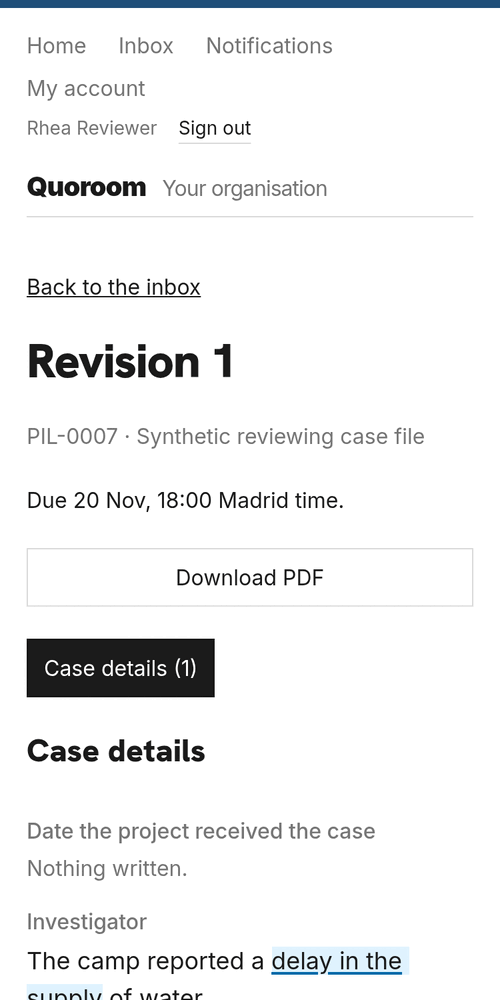

# Quoroom

A reporting system for Médecins Sans Frontières (MSF). A group reaches a *quorum* on a report without having to meet in a *room*: authors draft privately and share drafts, a committee reviews each revision in its own time before a deadline, and the report is approved, concluded and archived with its whole history. Built at Universitat Pompeu Fabra for the Project Management course (team 101_E), together with MSF's Ethics & Behaviour Unit, its first user.

<p>
  
</p>

> All data in this repository, its tests and its screenshots is synthetic. No real report, case or person is stored here.

Quoroom is general-purpose. Templates, roles and their permissions, units and the look (logo, colours, fonts, PDF header and footer) are data, set in the app. The ethics unit's two report templates ship as built-in templates that a template editor can copy and change.

What it does:

- **Templates** with sections, numbered subsections, repeated entries, rich text, branching, a cover, contents and a conclusion step, built in a template editor ([`docs/templates.md`](docs/templates.md)).
- **Private drafting.** Each author works on an autosaved working copy and shares it as the next draft. Two drafts shared at once are compared item by item.
- **Names and redaction.** Authors list each person with every spelling of their name; reviewers who should not see names only ever receive the redacted text, produced on the server. Images stay withheld until an author marks them safe.
- **Review rounds.** A revision goes to a committee with a deadline. Reviewers comment on selected text or whole sections and approve, request changes or comment. Reminders and outcomes arrive in an in-app inbox; the first request can be sent by WhatsApp from the author's phone.
- **Closing.** A round is decided by its approval rule or its deadline. The report ends with a closing revision or on approval and is archived, read-only, with a status grid and an audit log. Any draft or revision downloads as a PDF, made in the browser and never stored.

Iterations 1 and 2 were **Case Desk**, a triage desk for incoming cases. They stay online, frozen, on the demo environment, built from the git tags `iter1` and `iter2`; their code and scoring rules are in those tags.

## Environments

| Address | What it serves |
| --- | --- |
| `app.msf-case-desk.workers.dev` | The demo: the latest version, with synthetic data and team accounts |
| `iter1...`, `iter2.msf-case-desk.workers.dev` | Iterations 1 and 2, frozen at their git tags |
| `pilot.msf-case-desk.workers.dev` | The pilot with real reports: its own EU database, no demo data. Nobody reads or copies its data ([`docs/pilot.md`](docs/pilot.md)) |

## Stack

The project is built on the CAFE stack:

| Layer | Tool | Role here |
| --- | --- | --- |
| **C**loudflare | Workers, static assets, D1, Cron Triggers | One Worker per deployment serves the web app and the API; D1 (SQLite) stores everything, images included; a Cron Trigger runs the notification pass |
| **A**lchemy | Infrastructure as Effects | Each environment is one typed stack: [`alchemy.run.ts`](alchemy.run.ts) (demo) and [`alchemy.pilot.run.ts`](alchemy.pilot.run.ts) (pilot and test environments) |
| **F**oldkit | Elm Architecture on Effect | The web app: one Model per screen, fact-named Messages, the rich-text editor as a custom element |
| **E**ffect | Schema, services, layers, RPC | The domain rules, the storage services, and the typed API shared by the web app and the Worker |

Plus Tiptap for rich text, pdfmake for PDFs, Vite 8, Tailwind 4, Vitest 5, fast-check, Playwright, TypeScript 7, oxlint and oxfmt, with pnpm workspaces. The same Worker runs on plain `workerd` for self-hosting.

## Layout

```text
.
├── alchemy.run.ts          # demo stack: app and the frozen iterations
├── alchemy.pilot.run.ts    # pilot stack: the pilot and test environments
├── apps/
│   ├── api/                # the Worker: RPC API, authorization, redaction, notifications, D1
│   │   ├── migrations/     # expand-only SQL migrations
│   │   └── scripts/        # grant-admin, the workerd build, live checks
│   └── web/                # Foldkit single-page app
├── packages/
│   ├── domain/             # pure rules: templates, report flow, approval, redaction, the API contract
│   ├── pdf/                # the PDF renderer, for the browser and Node
│   └── e2e/                # browser tests on workerd
└── scripts/                # stacks, snapshots, migration and compatibility checks, smoke check
```

`packages/domain` has no clock, no randomness, no I/O and no UI: every rule is a pure function, the same in the browser, the Worker and the tests. The API contract is one Effect RPC group that both the web app and the Worker import, so a change to it fails the typecheck on both sides.

## Getting started

You need Node 24.11.1 or later and pnpm.

```sh
pnpm install
pnpm grant-admin --env workerd --email admin@example.org --name "Admin Example"   # prints a one-time link
pnpm workerd --mode pilot   # http://127.0.0.1:8787, then open the link
```

`pnpm workerd` without `--mode` runs the same Quoroom with the demo data: it also imports the accounts from `pnpm users:add`. Deploying to Cloudflare and running a host cron for notifications are in [`docs/self-hosting.md`](docs/self-hosting.md).

| Script | What it does |
| --- | --- |
| `pnpm workerd [--mode demo\|pilot] [port]` | Builds and serves everything on plain `workerd` with a local database |
| `pnpm grant-admin` | First administrator of an environment: a one-time activation link, `--reset` for a reset link |
| `pnpm infra:dev` | Runs the demo stack locally with live reload |
| `pnpm pilot:plan`, `pilot:deploy`, `pilot:destroy` | The pilot stack, stage `pilot` only |
| `pnpm test-env:up`, `test-env:down` | A throwaway test environment of the pilot stack |
| `pnpm smoke <address>` | Read-only check of a deployment |
| `pnpm --filter @case-desk/e2e e2e` | Browser tests on `workerd`: the pilot path and every route at phone and desktop width |
| `pnpm check` | Typecheck, lint, the migration check, tests and build, as CI does |
| `pnpm compat:check` | Runs each frozen version's storage tests on the latest schema |
| `pnpm snapshots:prepare` | Extracts the frozen iterations from their tags, for the demo stack |
| `pnpm users:add` | An account on the demo only, shared with the frozen `iter2` |

## Testing

- **Property tests** (fast-check) on the pure rules: generated templates, permissions from a template's roles, approval rules, comparison of drafts, redaction, numbering.
- **Repository contract tests**, one suite run in memory, on SQLite with every migration, on a fake D1 and on `workerd`, with the number of queries each operation may make.
- **API tests** with several accounts against the Worker's routes, above all what each one must not see.
- **Story and scene tests** (Foldkit) for every screen, without a browser.
- **Browser tests** (`packages/e2e`) on `workerd` in Chromium and Firefox: the pilot path, every route at 375 and 1280 px in its loaded, empty, loading and error states, keyboard use.
- **Compatibility**: `pnpm migrations:check` rejects migrations that would break an older version, and `pnpm compat:check` runs the storage tests of every frozen version on the latest schema ([`docs/compatibility.md`](docs/compatibility.md)).

## Documentation

- [`docs/self-hosting.md`](docs/self-hosting.md): `workerd`, the pilot and demo stacks, secrets, the host cron.
- [`docs/pilot.md`](docs/pilot.md): running a pilot, from the first administrator to backups and failures.
- [`docs/templates.md`](docs/templates.md): building a template, and the two built-in ones.
- [`docs/compatibility.md`](docs/compatibility.md): how versions share one database, and how a version is frozen.
- [`docs/decisions.md`](docs/decisions.md): decisions and measurements, including the two pinned Effect versions.

> [!NOTE]
> Alchemy v2 and Foldkit are both in beta. Versions are pinned exactly.

## Roadmap

| Step | When | Scope |
| --- | --- | --- |
| Iterations 1 and 2 (Case Desk) | until 6 Nov 2026 | Triage dashboard, case entry, rules per operational centre, backend on Cloudflare, sign-in |
| Iteration 3 (Quoroom) | 12 to 16 Nov 2026 | Templates as data, private drafting, redaction, review rounds, notifications, PDFs, template editor, theme, pilot stack |
| WhatsApp | next | Review requests and reminders through the WhatsApp Cloud API, first on the demo, then on the pilot |
| Pilot | 16 to 30 Nov 2026 | Real reports with the ethics unit, if it agrees |
| Guides for MSF | after WhatsApp | How to use Quoroom, for administrators, authors and reviewers |
| `iter3` freeze | after WhatsApp | Iteration 3 frozen at its tag on the demo environment, with its own contract tests |

## Licence

MIT. See [LICENSE](LICENSE).
