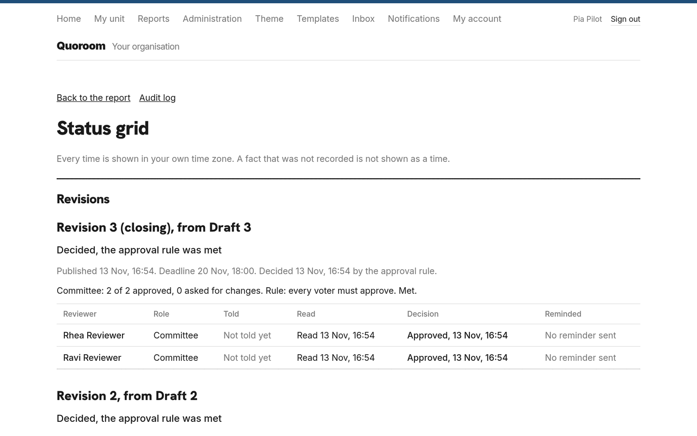
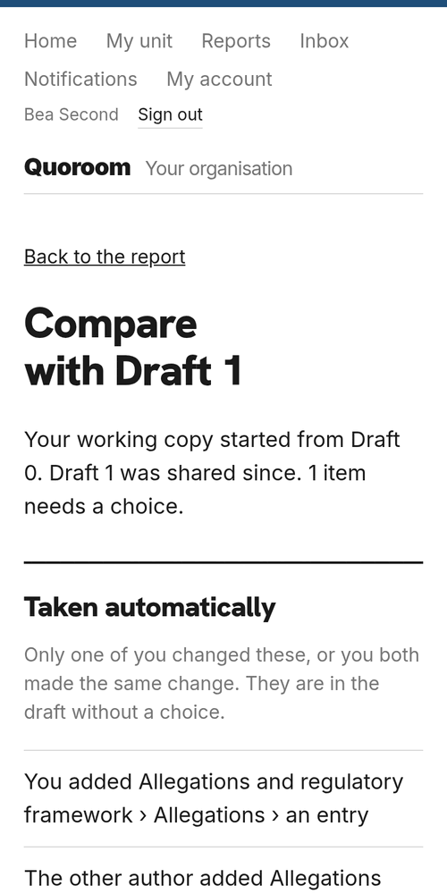

# Quoroom

A template-based reporting tool where a group reaches a *quorum* on a report without having to meet in a *room*. Authors draft privately and share drafts, a committee reviews each revision in its own time before a deadline, and the report is approved, concluded and archived with its whole history. Think of it as an asynchronous meeting room for any report that needs a committee's sign-off.

It was built at Universitat Pompeu Fabra for Médecins Sans Frontières (MSF), together with MSF's Ethics & Behaviour Unit, its first user, and fits any MSF department or humanitarian organisation with the same kind of reporting. It is open source and runs on Cloudflare, on any major cloud through OpenOrange, or on your own server.

https://github.com/user-attachments/assets/44f4dc7b-ae2e-430b-b52f-62d26eb697aa

<p>
  
</p>

> All data in this repository, its tests, its screenshots and the demo video is synthetic. No real report, case or person is stored here.

## What it does

Templates, roles and their permissions, units and the look (logo, colours, fonts, PDF header and footer) are data, set in the app. The ethics unit's two report templates ship as built-in templates that a template editor can copy and change.

- **Templates** with sections, numbered subsections, repeated entries, rich text, branching, a cover, contents and a conclusion step, built in a template editor ([`docs/templates.md`](docs/templates.md)).
- **Private drafting.** Each author works on an autosaved working copy and shares it as the next draft. Two drafts shared at once are compared item by item.
- **Names and redaction.** Authors list each person with every spelling of their name; reviewers who should not see names only ever receive the redacted text, produced on the server. Images stay withheld until an author marks them safe.
- **Review rounds.** A revision goes to a committee with a deadline. Reviewers comment on selected text or whole sections and approve, request changes or comment. Requests, reminders and outcomes arrive in an in-app inbox on Home. Sending them by e-mail, WhatsApp or another channel is an integration left to each deployment ([`docs/architecture.md`](docs/architecture.md#notifications-outside-the-app)).
- **Closing.** A round is decided by its approval rule or its deadline. The report ends with a closing revision or on approval and is archived, read-only, with a status grid and an audit log. Any draft or revision downloads as a PDF, made in the browser and never stored.

## Hosting

A deployment is one Worker, one SQLite database and a notification pass every minute, described once in [`infra/quoroom.ts`](infra/quoroom.ts). Each host reads that file:

| Host | Database | One command | |
| --- | --- | --- | --- |
| **Cloudflare**, on the free plan | D1, EU jurisdiction | `pnpm cloudflare:deploy` | Alchemy stack, [`infra/cloudflare.run.ts`](infra/cloudflare.run.ts) |
| **OpenOrange** by Rivet: AWS, Google Cloud, Azure, or your own Rivet Engine | D1 as a Rivet Actor | `pnpm openorange deploy --cluster <name>` | Wrangler configuration written by [`infra/openorange.ts`](infra/openorange.ts) |
| **Your own server**, on plain `workerd` | SQLite in a local folder | `pnpm workerd --mode pilot` | [`infra/workerd.sh`](infra/workerd.sh) |

Step by step, with the first account, secrets and alerts: [`docs/hosting.md`](docs/hosting.md).

## Getting started

You need Node 24.11.1 or later and pnpm.

```sh
pnpm install
pnpm grant-admin --env workerd --email admin@example.org --name "Admin Example"   # prints a one-time link
pnpm workerd --mode pilot   # http://127.0.0.1:8787, then open the link
```

`pnpm openorange dev` runs the same thing on OpenOrange instead (`--env openorange` for the link). `pnpm workerd` without `--mode` adds the demo accounts from `pnpm users:add`.

| Script | What it does |
| --- | --- |
| `pnpm workerd [--mode demo\|pilot] [port]` | Builds and serves everything on plain `workerd` with a local database |
| `pnpm openorange dev\|deploy\|database\|config` | Runs or deploys Quoroom on OpenOrange, on Rivet Cloud or your own Rivet Engine |
| `pnpm cloudflare:plan\|deploy\|destroy [stage]` | Quoroom on Cloudflare, one Worker and database per stage (`quoroom` by default) |
| `pnpm test-env:up\|down test_<name>` | A throwaway test environment on Cloudflare |
| `pnpm alerts:plan\|deploy` | An e-mail for new errors in the account's Workers |
| `pnpm grant-admin` | First account of an environment (People, Theme, Templates): a one-time activation link, `--reset` for a reset link |
| `pnpm smoke <address>` | Read-only check of a deployment |
| `pnpm rehearsal <address>` | The pilot script, driven through the web UI by seven invented people |
| `pnpm --filter @quoroom/e2e e2e` | Browser tests on `workerd`: the pilot path and every route at phone and desktop width |
| `pnpm check` | Typecheck, lint, the migration check, tests and build, as CI does |
| `pnpm compat:check` | Runs each frozen version's storage tests on the latest schema |
| `pnpm demo:plan\|deploy`, `snapshots:prepare`, `users:add` | The course's demo stack, with the frozen iterations |

## Stack

The project is built on the CAFE stack:

| Layer | Tool | Role here |
| --- | --- | --- |
| **C**loudflare | Workers, static assets, D1, Cron Triggers | One Worker per deployment serves the web app and the API; D1 (SQLite) stores everything, images included; a Cron Trigger runs the notification pass |
| **A**lchemy | Infrastructure as Effects | The Cloudflare deployments as typed stacks in [`infra/`](infra) |
| **F**oldkit | Elm Architecture on Effect | The web app: one Model per screen, fact-named Messages, the rich-text editor as a custom element |
| **E**ffect | Schema, services, layers, RPC | The domain rules, the storage services, and the typed API shared by the web app and the Worker |

Plus Tiptap for rich text, pdfmake for PDFs, Vite 8, Tailwind 4, Vitest 5, fast-check, Playwright, TypeScript 7, oxlint and oxfmt, with pnpm workspaces. Alchemy v2 and Foldkit are both in beta, so versions are pinned exactly.

```text
.
├── infra/          # hosting: what a deployment is, and Cloudflare, OpenOrange and workerd
├── apps/
│   ├── api/        # the Worker: RPC API, authorization, redaction, notifications, migrations
│   └── web/        # Foldkit single-page app
├── packages/
│   ├── domain/     # pure rules: templates, report flow, approval, redaction, the API contract
│   ├── pdf/        # the PDF renderer, for the browser and Node
│   └── e2e/        # browser tests and the rehearsal
└── scripts/        # snapshots, migration and compatibility checks, smoke check, logs
```

## Testing

- **Property tests** (fast-check) on the pure rules: generated templates, permissions from a template's roles, approval rules, comparison of drafts, redaction, numbering.
- **Repository contract tests**, one suite run in memory, on SQLite with every migration, on a fake D1 and on `workerd`, with the number of queries each operation may make.
- **API tests** with several accounts against the Worker's routes, above all what each one must not see.
- **Story and scene tests** (Foldkit) for every screen, without a browser.
- **Browser tests** (`packages/e2e`) on `workerd` in Chromium and Firefox: the pilot path, every route at 375 and 1280 px in its loaded, empty, loading and error states, keyboard use. The rehearsal runs the pilot script end to end on any host.
- **Compatibility**: `pnpm migrations:check` rejects migrations that would break an older version, and `pnpm compat:check` runs the storage tests of every frozen version on the latest schema ([`docs/architecture.md`](docs/architecture.md)).

## Documentation

- [`docs/hosting.md`](docs/hosting.md): Cloudflare, OpenOrange and your own server, the first account, secrets, alerts.
- [`docs/operating.md`](docs/operating.md): running a deployment with real reports, from the first account to backups and failures, and the pilot script.
- [`docs/architecture.md`](docs/architecture.md): who Quoroom is for, how it is built, and how versions share one database.
- [`docs/templates.md`](docs/templates.md): building a template, and the two built-in ones.
- [`docs/api.md`](docs/api.md): the API contract, procedure by procedure, and the image route.
- [`docs/decisions.md`](docs/decisions.md): decisions and measurements.

## Status

Quoroom was the third and final iteration of a Project Management course project at Universitat Pompeu Fabra (team 101_E), from October to November 2026. Iterations 1 and 2 were **Case Desk**, a triage desk for incoming cases; the git tags `iter1`, `iter2` and `iter3` mark each delivery.

## Licence

MIT. See [LICENSE](LICENSE).
